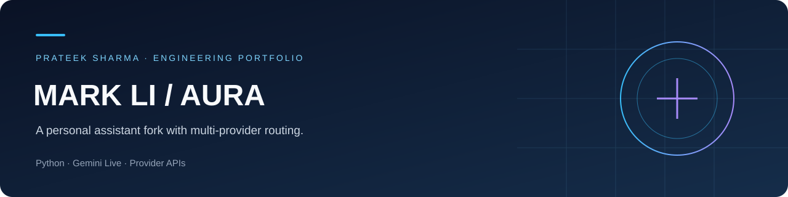

# Mark Li / Aura

A personal assistant fork with multi-provider routing.

**Focus:** AI Engineer / SDE  
**Stack:** Python · Gemini Live · Provider APIs

[LinkedIn](https://www.linkedin.com/in/prateek-sharma-97a064296/) · [Portfolio projects](docs/PORTFOLIO.md)

## Project overview

Mark LI desktop assistant.

## Engineering highlights

- Real-time voice assistant with desktop-action modules
- Key-pool rotation and provider fallback routing
- Dashboard, plugin structure and configuration templates
- Preserved upstream attribution, credits and license

## What I learned

I learned a lot by working through this project: reading code, troubleshooting integrations, comparing approaches, and understanding how individual components become a complete application. The main takeaways were:

- Reading and extending an existing modular assistant codebase.
- Handling quotas, rotating key pools and classifying provider errors.
- Understanding why voice, text and vision require different fallback strategies.

## Getting started

Run the following from the repository root in PowerShell. Install the required Python/Node.js runtimes first and use your own credentials where required.

```powershell
py -3.11 -m venv .venv
& .venv/Scripts/Activate.ps1
pip install -r requirements.txt
python -m playwright install chromium
Copy-Item config/api_keys.example.json config/api_keys.json
# Add your own credentials to the local config
python main.py
```

## Repository map

| Path | Contents |
|---|---|
| `actions /` | System and application action modules |
| `AURA_PROGRESS.md` | Project source, documentation or configuration |
| `config /` | Configuration templates and assets |
| `core /` | Assistant runtime and model integration |
| `CREDITS.md` | Project source, documentation or configuration |
| `dashboard /` | Project modules and assets |
| `desktop /` | Project modules and assets |
| `LICENSE` | Project source, documentation or configuration |
| `main.py` | Project source, documentation or configuration |
| `memory /` | Project modules and assets |
| `pictures /` | Project modules and assets |
| `plugins /` | Extension modules |
| `requirements.txt` | Project source, documentation or configuration |
| `setup.py` | Project source, documentation or configuration |
| `Start-AURA.bat` | Project source, documentation or configuration |
| `ui.py` | Project source, documentation or configuration |

## Downloads

[Open project releases](https://github.com/PRATEEK638/mark-li/releases/tag/local-import-2026-10-10)

| File | Size | SHA-256 |
|---|---:|---|
| `jarvis.mp4` | 126.2 MiB | `efa8df0ce531d26073a8a1aa9dacbba8f41d63d13ee7494b029269bcacdbcfb4` |

## Attribution and scope

This repository contains a personal fork or study snapshot of the Mark assistant projects by **FatihMakes**. Upstream authorship, documentation and license remain intact. The original assistant implementation is not presented as my own work. See the included license and credits where available.

## Project status

This is a development or study snapshot. Source import and upload checks are separate from runtime validation; the application and model behavior have not been retested as part of preparing this portfolio.

## Existing project documentation

<details>
<summary>Setup details, implementation notes and original documentation</summary>

# AURA

A real-time voice assistant that hears, sees and controls this machine. Built
on the Gemini Live API for native full-duplex audio, with a multi-provider
fallback tier so a spent quota degrades the assistant instead of stopping it.

> Personal, non-commercial fork of [Mark LI](https://github.com/FatihMakes/Mark-LI)
> by FatihMakes. See [CREDITS.md](CREDITS.md) and [LICENSE](LICENSE).

---

## Quick start

```bash
.venv\Scripts\activate          # Windows
python main.py
```

First run only:

```bash
py -3.11 -m venv .venv
.venv\Scripts\python.exe -m pip install -r requirements.txt
.venv\Scripts\python.exe -m playwright install chromium
```

Requires Python 3.11 or 3.12 and a working microphone.

---

## How model routing works

The single biggest change from upstream. The original read one Gemini key from
config and called it directly from ~15 places, so one exhausted free-tier quota
took the whole assistant offline. Now:

```
VOICE   gemini_voice_api_key ──► Gemini Live          (no fallback exists)

TEXT    gemini_api_keys      ──► Gemini      3 keys ─┐
          on 429, rotate the pool, then the provider │
        openrouter_api_keys  ──► OpenRouter  5 keys ─┤
        nvidia_api_key       ──► NVIDIA NIM  1 key  ─┤
        sarvam_api_keys      ──► Sarvam      4 keys ─┘
```

Three rules hold it together:

1. **Pools before providers.** A rate limit is per key, not per account, so an
   exhausted key rotates to the next one in its pool. Only when the whole pool
   is spent does the provider hand off to the next one down the chain.
2. **Voice quota is ring-fenced.** `gemini_voice_api_key` is kept out of the
   text pool entirely. Voice is the only subsystem with nothing to degrade to —
   text work has three alternatives, so it never gets to mute the assistant.
3. **Fallbacks fail loudly when they'd be wrong.** A request carrying a
   screenshot, or one that depends on Gemini's `google_search` grounding, is not
   silently re-routed to a text-only provider that would answer by guessing. It
   raises instead.

A provider that burns its whole pool is rested for 15 minutes rather than
retried on every call.

### The moving parts

| File | Role |
| --- | --- |
| `core/keyring.py` | Key pools, rotation, cooldowns, error classification |
| `core/cloud_llm.py` | One `/v1/chat/completions` transport for OpenRouter, NVIDIA and Sarvam |
| `core/ai_router.py` | Gemini-first entry point every action module calls |

When Gemini answers, callers get Gemini's own response object back untouched.
Only a fallback returns a shim, and it carries `.text`.

---

## Configuration

Everything lives in `config/api_keys.json`, which is gitignored.

```jsonc
{
  "assistant_name": "AURA",
  "user_name": "Ayush",

  "gemini_api_keys":      ["...", "...", "..."],   // text + vision pool
  "gemini_voice_api_key": "...",                   // reserved for Live voice
  "openrouter_api_keys":  ["...", "..."],
  "nvidia_api_key":       "...",
  "sarvam_api_keys":      ["...", "..."],

  "cloud_fallback_order": ["gemini", "openrouter", "nvidia", "sarvam"]
}
```

Edit `gemini_api_keys`, not `gemini_api_key` — the latter is an alias the
keyring keeps pointing at whichever pool entry is currently active, so the
older call sites that read it directly stay correct.

Environment variables (`GEMINI_API_KEY`, `OPENROUTER_API_KEY`, `NVIDIA_API_KEY`,
`SARVAM_API_KEY`) override the file; comma-separate to pass a pool.

Check what the router can currently see:

```bash
python -m core.selftest
```

---

## Capabilities

| | |
|---|---|
| Voice | Full-duplex Gemini Live, any language, affective dialog, proactive audio |
| Vision | Screen capture and webcam streamed into the live session |
| System | Apps, volume, brightness, WiFi, power, shortcuts, windows |
| Web | Multi-mode search — news / research / price / compare — Gemini grounding first, DDG fallback |
| Files | Read, summarise and answer questions about local documents |
| Code | Inline review, debugging, generation, and a multi-step dev agent |
| Memory | Persistent identity, preferences, projects, session summaries |
| Plugins | Drop a `.py` file into `plugins/` — loaded on next launch, crash-isolated |
| Remote | Phone dashboard over QR pairing |

Plugins: copy `plugins/_template.py`, fill in the `PLUGIN` dict and `run()`.
A broken plugin shows as BROKEN in the manager and cannot take the engine down.

---

## Licence

CC BY-NC 4.0, inherited from upstream — personal and non-commercial use only.


</details>
